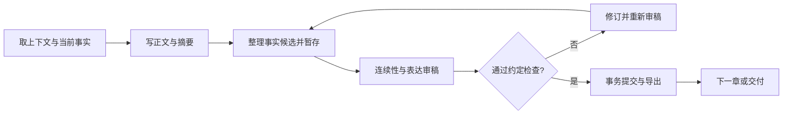

# 中文小说工作台 · Novel Workbench

一套可在聊天中使用的中文小说创作 Skill：从创意、分卷规划到逐章写作、专项修改、审稿与续写，用本地故事账本保存已验收正文和事实。

**当前版本：0.1.0，首版。** 适合希望保留作者判断、同时减少长篇状态混乱的创作流程。它不自带模型，不承诺文学质量或无人值守写完一部好小说。

## 为什么做这个整合版

参考多个开源项目的设计方向，将常见的写作流程、专项写作指导、事实追踪、版本审稿和可视化进度组织在一个轻量技能里。代码和说明独立实现，未捆绑其他仓库代码、提示词全文或小说语料。

| 能力 | 本版做法 |
|---|---|
| 简洁开工 | 信息够就开始，短篇不强制跑长篇流程 |
| 专项改稿 | 按开头、对白、因果、人物、转场、节奏、章末和文风问题加载指导 |
| 长篇状态 | 区分未来规划、正文事实、人物认知与未回收伏笔 |
| 正文计数 | 默认只统计 `## 正文` 区，按项目上下限和口径实测 |
| 版本审稿 | 报告绑定正文、来源、摘要与事实候选，内容变化后旧报告失效 |
| 可靠提交 | SQLite事务、顺序章节、head核对；不合格草稿不标为完成 |
| 中断恢复 | 根据账本继续；导出中断可重建，不重复提交章节 |
| 历史修订 | 新建重写分支，保留原项目，防止旧事实直接污染改稿 |
| 只读面板 | 离线HTML显示章节、待处理项、事实来源和到期伏笔 |

参考项目包括 [chinese-novelist-skill](https://github.com/PenglongHuang/chinese-novelist-skill)、[Chinese-WebNovel-Skill](https://github.com/Tomsawyerhu/Chinese-WebNovel-Skill)、[webnovel-writer](https://github.com/lingfengQAQ/webnovel-writer)、[MyNovel](https://github.com/xiaofeng-928/chinese-longnovel-skill) 与 [MuMuAINovel](https://github.com/xiamuceer-j/MuMuAINovel)。设计取舍及范围见 [来源说明](references/sources.md)。这些项目未为本项目背书。

## 安装与使用

需要支持本地 Skill 与文件操作的 Agent；账本脚本需要 **Python 3.10+**，不需要第三方 Python 包、数据库服务器、Embedding 服务或单独的模型 API Key。模型调用由当前宿主提供，其费用与隐私规则仍适用。

使用支持的 skills 安装工具：

```sh
npx skills add dreamlikehu-lgtm/novel-workbench
```

或将仓库下载为ZIP并解压，将包含 `SKILL.md` 的文件夹放入宿主技能目录。例如 Codex 的默认位置为 `~/.codex/skills/novel-workbench`。具体技能发现与重载方式以宿主环境为准。本项目未验证所有 Agent 宿主，说明会按实际使用反馈更新。

安装后可以这样说：

```text
使用 $novel-workbench，帮我规划一部12章的悬疑小说。
先给我人物、大纲和一段能体现文风的试写，确认后再写正文。
每章2000到3500汉字，少一些解释性的心理总结。
```

```text
使用 $novel-workbench，继续这部小说的下一章。
先核对人物当前知道什么、钥匙归谁、哪些伏笔已到期。
```

```text
使用 $novel-workbench，修改第三章的对白。
保留既有事实，重点让两个人的声音和谈话目的更清楚。
```

不想建账本时，单段或短篇改稿可直接在聊天中完成。需要跨章连续创作时，由助手创建项目、运行脚本并维护状态，不要求作者手工编辑JSON。

## 一章如何完成



两种审稿维度不自动等于两名独立审稿人。宿主支持且用户同意时可由不同代理执行；同一代理分轮复查时须如实说明。脚本不能证明审稿人身份、审稿诚实性或文学判断正确。

## 助手命令入口

```sh
python3 scripts/novel.py --help
python3 scripts/novel.py init ./books/回声之前 --title "回声之前" --planned-chapters 12 --minimum 2000 --maximum 3500
python3 scripts/novel.py context ./books/回声之前 --focus "林舟,钥匙"
python3 scripts/novel.py status ./books/回声之前
python3 scripts/novel.py dashboard ./books/回声之前
```

Windows 可使用 `py -3` 替代 `python3`。助手在其他工作目录运行时使用技能脚本的绝对路径。完整stage/review/commit数据契约见 [运行参考](references/runtime.md)。

项目同时保存可读的设定/规划/文风文件和隐藏的 `.novel/ledger.sqlite3`。**备份小说时要备份整个项目目录，包含隐藏文件。** 默认忽略仓库内的 `books/` 和SQLite文件，避免误将私人书稿提交到技能源码仓库。

## 测试与当前边界

```sh
python3 -m unittest discover -s tests -v
```

测试使用临时目录与合成审稿记录，覆盖正文计数、规格执行、报告失效、失败阻断、证据来源、事实回放、历史分支、手改保护、导出恢复、并发提交和面板HTML转义。**这些测试验证运行机制，不是小说效果盲评。** CI配置在Linux、macOS、Windows的Python 3.10与3.13上运行；实际CI结果以Actions为准。

首版检索为精确关键词匹配，面板为静态只读快照。暂不内置向量检索、图形化编辑、自动导入整本旧小说、EPUB导出或平台发布。脚本检查证据片段是否存在，不证明其语义必然支持事实；连续性审稿仍须认真核对。

## 反馈与许可

欢迎提供可复现问题：使用环境、执行命令、脱敏错误和最小化示例。不要在Issue里提交API密钥或私人书稿。

本项目原创代码与说明采用 [MIT License](LICENSE)。示例为原创微型测试内容；不包含第三方小说语料。

---

**English:** A local-first Chinese fiction-writing skill with targeted craft guidance, a SQLite story ledger, version-bound reviews, sequential commits, resumable exports, rewrite branches, and an offline read-only dashboard. Python standard library only. Literary quality and review honesty remain human/model judgments.
